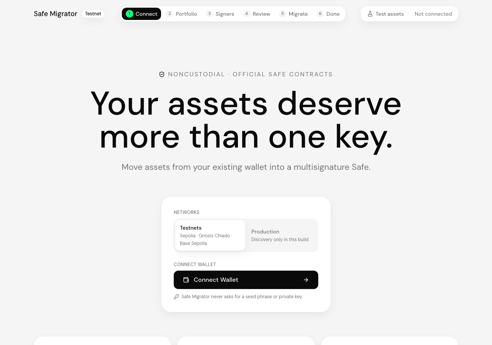
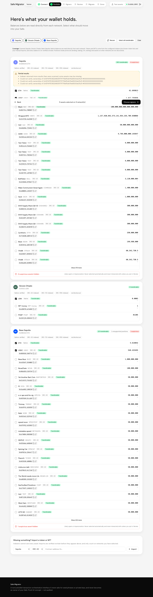
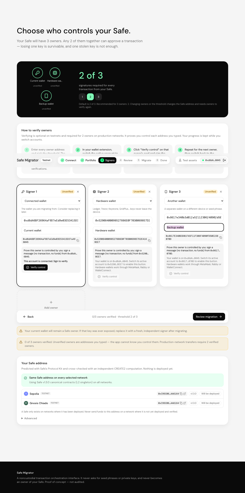
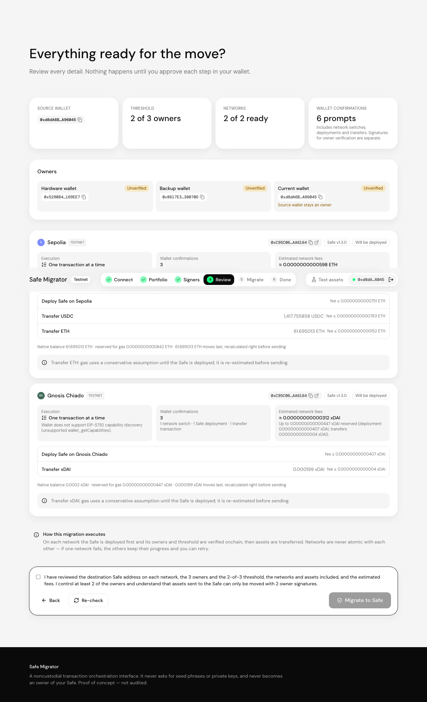

# Safe Migrator

**Move the assets in an existing wallet (EOA) into a multi-signature Safe (2-of-3 by default) on several EVM networks, from one guided flow.**

Safe Migrator connects your wallet and discovers what it holds on each supported network. It then
helps you choose the owners and threshold, predicts the Safe address (the same address on every compatible
network), deploys the Safe with the official Safe contracts, transfers the selected assets and
verifies the result onchain. It is a **noncustodial orchestration interface**: your wallet signs
every action, the app holds no keys, and it never becomes a Safe owner.

> One migration intent, not one transaction. The preview screen tells you exactly how many wallet
> confirmations, network switches and transactions each network needs before you start.

| Connect | Discover | Choose signers | Preview |
| --- | --- | --- | --- |
|  |  |  |  |

The screenshots show real Sepolia + Chiado discovery and preflight for a read-only address. The
preview's fee figures come from real `eth_estimateGas` simulations of the deployment and transfers.

---

## Status: implemented, experimental and future

### Implemented and tested
* **Wallet connection** through EIP-6963 injected wallets (MetaMask, Rabby, Coinbase Wallet, Frame, …)
  and, optionally, WalletConnect. The app detects a plain EOA, an EIP-7702-delegated EOA, or a contract wallet.
* **Multichain discovery.** Native balances come from RPC. ERC-20, ERC-721 and ERC-1155 holdings come
  from an indexer (Blockscout by default, Alchemy optional) and are then **re-read onchain** at a single
  block. The app also checks a known-token list and supports manual token/NFT import.
  * Assets are classified as transferable, specialized, non-transferable, unsupported or suspicious;
    spam heuristics hide likely scam tokens by default.
  * RPC and indexer failures are reported per network; they are never treated as "zero balance".
* **Signer setup.** 2-of-3 by default; add or remove owners (1–10) and pick any threshold.
  Addresses are validated, ENS is resolved, duplicates are rejected and owners are sorted
  deterministically. 1-of-N and N-of-N need an explicit risk acknowledgment, and the app warns when
  the source EOA stays an owner.
* **Owner verification** by EIP-712 signature (EOAs, plus contract wallets via ERC-1271/6492). Each
  challenge is single-use, expires after 10 minutes and is bound to the Safe configuration hash.
* **Deterministic Safe addresses** via Safe Protocol Kit, cross-checked by an independent CREATE2
  computation. The Safe version is negotiated so Sepolia, Chiado and Base Sepolia get the **same address**
  (v1.3.0); see [docs/SAFE_DEPLOYMENT.md](docs/SAFE_DEPLOYMENT.md).
* **Existing-Safe detection.** A matching Safe already at the predicted address is reused. A mismatching
  contract blocks that network.
* **Deploy, verify, then transfer.** One-by-one, the app verifies the owners, threshold, singleton,
  modules, guard and fallback handler onchain before any asset moves. In an atomic batch, the
  deployment is the first call and the transfers revert unless it creates exactly the expected Safe.
* **Transfer adapters:**
  * Native transfers go last, after reserving gas.
  * ERC-20 uses `transfer` with live balances and no approvals.
  * ERC-721 uses `safeTransferFrom`.
  * ERC-1155 uses `safeTransferFrom` / `safeBatchTransferFrom`.
  * Every transfer is simulated first and verified afterwards by balance or ownership reads, so
    fee-on-transfer tokens show up as discrepancies.
* **Gas management.** Per-network estimates for deployment and transfers, including the OP-stack L1
  data fee. The app blocks deficits, keeps a native reserve and applies a dust policy. All amounts are
  BigInt; the margins are configurable.
* **Execution engine.** A typed state machine tracks per-action intents. Hashes are persisted before
  the app waits for them, so an interrupted session reconciles from receipts instead of re-sending.
  You can Resume, Retry failed actions or Pause. A pending-nonce guard and a single-run guard
  prevent duplicate execution.
* **Production-network gating.** Production execution is off unless it is enabled by environment
  variable *and* allow-listed per chain, *and* at least `threshold` owners are verified by signature.
* **Testnet tools** (`/testnet`): faucets, plus one-click deployment of sample assets that exercise
  each edge case (fee-on-transfer, restricted, soulbound, ERC-721, ERC-1155).
* **Receipt export (JSON)**, an "Open in Safe{Wallet}" link, and security follow-up recommendations.
* **Follow-up migrations.** "Start a new migration" rescans the wallet for assets that arrived later,
  keeping owners and threshold so they go to the same Safe. Reconnecting after a completed run opens
  a fresh portfolio scan, and replaced runs are archived locally (last 10).

### Experimental (implemented; validation depends on the wallet)
* **EIP-5792 atomic batching (EIP-7702 wallets).** On wallets that batch, such as MetaMask's smart
  account (EIP-7702 to the wallet's own delegate), each network takes **one batch** for the Safe
  deployment plus every token and NFT transfer, then one native transfer. Detection uses
  `wallet_getCapabilities`, execution uses `wallet_sendCalls` with `atomicRequired: true`, and
  results are tracked with `wallet_getCallsStatus`. If the wallet cannot batch, the app falls back
  to sequential transactions. Verified on a Sepolia fork with a real EIP-7702 transaction; not yet
  with a real wallet. See [docs/BATCHING.md](docs/BATCHING.md).
* **Production networks** (Ethereum, Base, Arbitrum, Optimism, Polygon). Discovery and planning work.
  Execution is gated and still needs the independent validation run described in
  [docs/SECURITY.md](docs/SECURITY.md).

### Future work
See the [V2 backlog](#v2-backlog) below.

---

## Quick start

Requirements: Node.js 20+ and npm.

```bash
npm install
cp .env.example .env.local      # optional; the defaults work on testnets with public RPCs
npm run dev                     # http://localhost:3000
```

All credentials, such as RPC and indexer keys, are **server-only** environment variables. They are
used only by the read-only `/api/rpc/[chainId]` proxy and by `/api/discovery`, and they never reach the
browser bundle. The proxy forwards an allow-list of read methods and rejects signing and broadcasting
methods. See [.env.example](.env.example) for every option.

### Scripts

| Command | What it does |
| --- | --- |
| `npm run dev` / `build` / `start` | Next.js dev server / production build / production server |
| `npm run typecheck` / `lint` | `tsc --noEmit` / ESLint |
| `npm test` | Vitest unit tests (offline) |
| `npm run test:network` | Read-only checks against live Sepolia, Chiado and Base Sepolia (version negotiation, address parity) |
| `npm run test:fork` | **End-to-end migration on local forks of Sepolia + Chiado** (see below) |
| `npm run test:e2e` | Playwright UI smoke tests (run `npm run build` and `npx playwright install chromium` first) |
| `npm run compile:contracts` | Recompiles the testnet sample contracts into `src/lib/testnet/artifacts.json` |
| `node scripts/screenshots.mjs` | Regenerates `docs/screenshots/*` against a server on port 3100 |

## Testnet demonstration

The full walkthrough is in [docs/TESTNET_GUIDE.md](docs/TESTNET_GUIDE.md). In short:

1. Get Sepolia ETH and Chiado xDAI from the faucets listed on `/testnet`. About 0.05 of each is plenty.
2. On `/testnet`, deploy the sample assets on both networks (for example, Demo USD, the fee token and
   the restricted token). They are added to discovery automatically.
3. On `/`, connect, select assets, enter the owners and threshold, review the preview and click **Migrate to Safe**.
4. Approve each prompt. One-by-one, that means 1 deployment plus 1 transaction per asset on each
   network, plus a network switch. With atomic batching it is 1 batch plus 1 native transfer per network.
5. The completion screen re-reads the Safe and both balances onchain and links to Safe{Wallet}.

## How it was verified

| Layer | How | Real or mocked |
| --- | --- | --- |
| Math, validation, classification, planning, state machine, deployment-calldata inspection, EIP-712 challenges | `npm test` (115 tests) | Pure logic. Signatures are real (viem accounts). |
| Executor control flow (rejection, retry, resume, dropped transactions, deploy-in-batch, batch revert, batching fallback, gating) | `npm test` | Wallet and chain **mocked** |
| EIP-5792 capability and status parsing | `npm test` | Wallet responses **mocked** |
| Canonical contracts, version negotiation, same address on Sepolia, Chiado and Base Sepolia | `npm run test:network` | **Live** testnet reads |
| Full migration: discovery → plan → Protocol Kit deployment → transfers → onchain verification, on both chains | `npm run test:fork` (6 scenarios) | **Real EVM execution on local forks** with the real Safe contracts and throwaway keys |
| UI flows (connect, discover, testnet page, RPC proxy rejects broadcasts) | `npm run test:e2e` | Real server and real RPC reads; read-only injected wallet |

The fork suite covers the following scenarios:
* The same Safe address is deployed on both chains, with owners and threshold verified.
* mUSD and native balances arrive in full.
* The fee-on-transfer token is flagged `verified_with_discrepancy`.
* The restricted token is excluded by simulation and stays in the source.
* An existing matching Safe is reused and no deployment is sent.
* A rejected transfer stops the run; Retry resumes without redeploying.
* A session killed right after a transfer's hash was saved resumes **without resending** it.
* One EIP-7702 batch deploys a **3-of-5** Safe and moves an ERC-20, three ERC-721s and an ERC-1155
  collection; the native remainder follows as one transaction.

A one-by-one migration has been run on public Sepolia through a real browser wallet. Not yet done:
an atomic batch through a real wallet's EIP-5792 implementation.

---

## Documentation

* [docs/ARCHITECTURE.md](docs/ARCHITECTURE.md): service map, state model and design decisions
* [docs/SAFE_DEPLOYMENT.md](docs/SAFE_DEPLOYMENT.md): how deterministic Safe deployment works here
* [docs/BATCHING.md](docs/BATCHING.md): which kinds of batching are and are not supported, and why
* [docs/SECURITY.md](docs/SECURITY.md): security model, assumptions, limitations and the mainnet checklist
* [docs/TESTNET_GUIDE.md](docs/TESTNET_GUIDE.md): faucets, sample assets and demo scenarios
* [docs/MILESTONES.md](docs/MILESTONES.md): milestone status
* [docs/POC_REVIEW.md](docs/POC_REVIEW.md): PoC hardening findings and fix status
* [docs/POC_VALIDATION.md](docs/POC_VALIDATION.md): manual real-wallet validation checklist

## Design system

The UI follows the Safe brand styleguide and Safe{Wallet}'s light theme. All tokens are in
[`src/app/globals.css`](src/app/globals.css):
* **Palette**, with the exact hex values: Safe Green `#12FF80`, Safe Labs Green `#7FFAB7`, the Labs
  accents `#E7FFF2` and `#D0FFE6`, Safe Black `#0A0A0A`, Bg Grey `#F5F5F5` and Bg Dark `#262626`.
  Primary CTAs use Safe Black, with Bg Dark on hover.
* **Type scale** as utilities: `text-hero` (86/100), `tagline` (16/120, caps, 2.4px tracking),
  `text-hero-body` (22/120), `text-h2` (40/120), `text-h3` (24/120), `text-lead` (18/28),
  `text-special` (48/120). Body text is 16/24 and headlines use Medium weight.
* **Rhythm:** `section` (96px) and `block` (64px) spacing tokens.

**Fonts.** Citerne is first in the font stack. DM Sans, the sanctioned fallback, is self-hosted
through `@fontsource`. To embed Citerne, add `@font-face` rules for Citerne Regular and Medium in
`globals.css` pointing at files in `public/fonts/`.

**Logo.** The official Safe logo files are not bundled; the header shows a text wordmark. Add the
supplied logo assets unmodified if this ships as a Safe product.

## Repository layout

```
src/app/                 Pages (/, /testnet) and API routes (/api/rpc/[chainId], /api/discovery)
src/components/          Screens, state provider, hooks, UI primitives
src/lib/chains/          Network registry, execution gating, RPC policy, clients
src/lib/domain/          Types and BigInt amount math
src/lib/services/        Discovery, signers, deployment, gas, capabilities, planning, transfer, execution, verification
src/lib/state/           Migration state machine and local persistence
contracts/               Testnet-only sample assets (never for mainnet)
tests/unit|integration|e2e
```

## V2 backlog

1. **Real-wallet batching validation** across MetaMask, Coinbase Smart Wallet, Rabby and Ambire.
   Once wallets expose the batch's gas parameters, move the native remainder into the batch as well.
2. **Gas sponsorship** through ERC-4337 paymasters or the Safe relay, so networks that hold only
   tokens do not need native gas.
3. **Safe v1.4.1 on every network** once Chiado (or a replacement testnet) carries canonical v1.4.1, and
   `SafeL2` vs `Safe` choice per network where parity is not required.
4. **Protocol position adapters** for unwinding or migrating Aave/Compound positions, LP NFTs and
   staking receipts, with per-protocol review.
5. **Approval hygiene:** list and revoke the EOA's existing ERC-20/NFT approvals after migration.
6. **Hardware-wallet owner verification UX** that guides the user through account switching for
   Ledger/Trezor, plus Safe-owner verification (owner is itself a Safe).
7. **Post-migration owner rotation:** prepare the Safe transaction that replaces the source EOA as
   owner, for signing in Safe{Wallet}.
8. **More indexers and pricing** (Zerion, Moralis, Covalent) with cross-indexer agreement checks.
9. **More networks:** zkSync and other chains where the Safe address differs or deployment is
   non-canonical, shown as separate addresses.
10. **Server-side receipts and notifications:** optional, user-owned, never custodial.

## License

MIT. The testnet sample contracts in `contracts/` are unaudited demo code.
